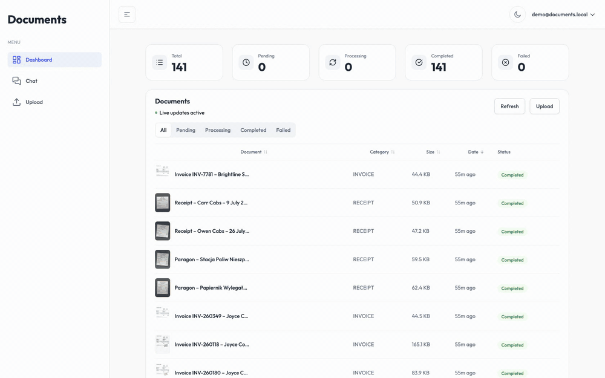
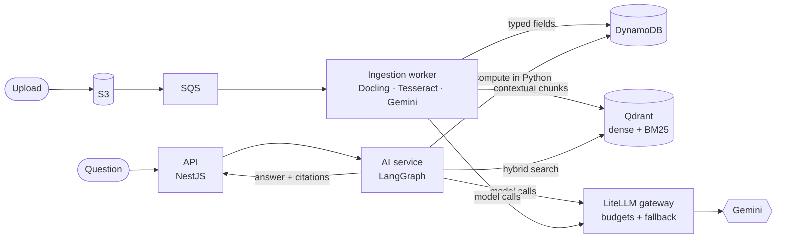
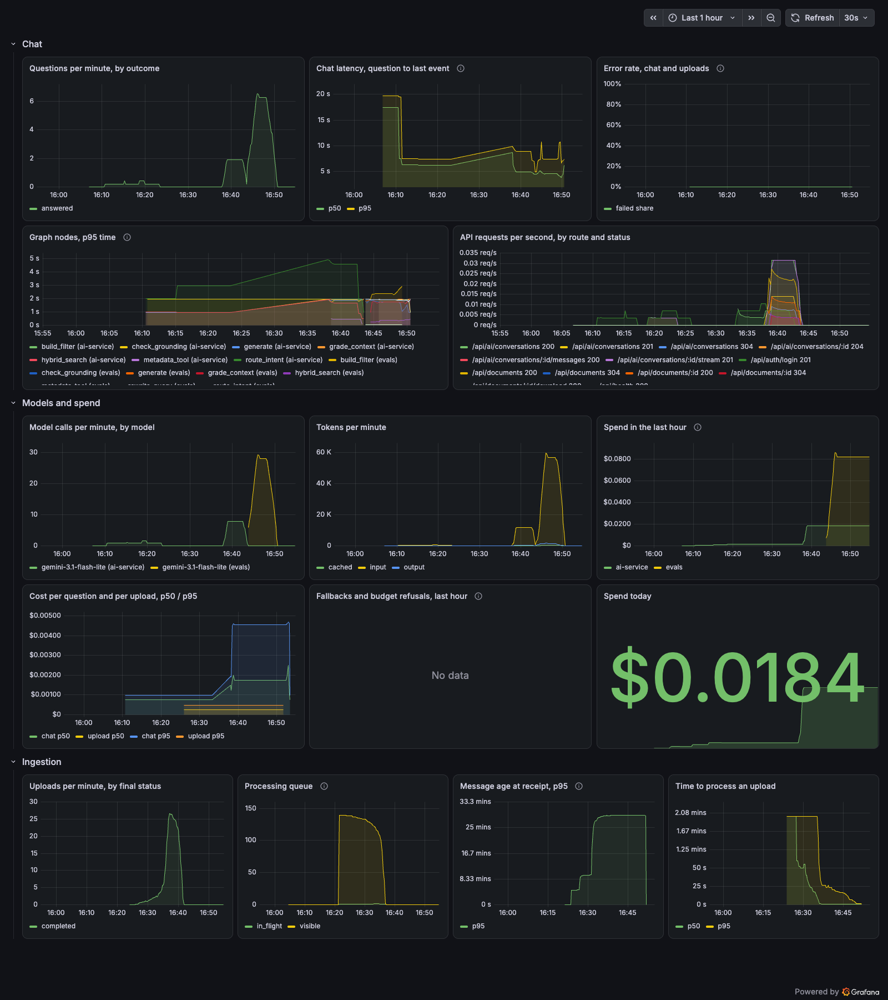

# Documents

[](https://github.com/rafjasn/documents/actions/workflows/ci.yml)
[](https://github.com/rafjasn/documents/actions/workflows/eval.yml)

Ask questions across invoices, receipts and contracts in English or Polish, with answers linked to the source page. Built around an evaluation harness for answer quality, retrieval and extraction.



- **Document processing:** PDF, DOCX, scans and photos; OCR, figure captions and typed financial fields.
- **Retrieval and answers:** contextual hybrid search, LangGraph orchestration, calculations in Python and highlighted citations.
- **LLMOps:** evaluated prompt versions, daily spending limits, model fallback, distributed tracing and Grafana alerts.
- **Access control:** JWT authentication, tenant-scoped retrieval and prompt-injection controls.

## Results

72 held-out questions from a hand-reviewed set of 144 across 200 documents:

| Measure | Result |
|---|---|
| Correct answers | **70/72 (97%)**, versus 43/72 (60%) for the single-document baseline |
| Questions across documents | 9/10 (90%), versus 0/10 |
| Totals, counts and averages | 12/12 (100%), versus 2/12 (17%) |
| Polish questions | 27/28 (96%), versus 16/28 (57%) |
| Citations that point to a relevant document and page | 0.986 |
| Faithfulness: answers whose every claim is in their sources | 0.972 (70/72), judged by Gemma 4, a different model family from the one answering |
| Latency, p50 / p95 | 3.8 s / 6.08 s |
| Model cost per question | $0.00286 |

The baseline receives the correct document; library chat must retrieve its sources. This is a small domain-specific benchmark, measured on an M2 with 8 GB RAM. [Full results and methodology](docs/RESULTS.md).

- **Retrieval** (dev split): MRR@10 0.909 and recall@10 0.941 at 17 ms per query, from contextual chunks with multilingual dense vectors and BM25.
- **Extraction** (test split): field F1 0.996 on invoices, receipts and contracts, including scans and phone photos.
- **Prompt injection:** attack success fell from 42.4% with the baseline defences to 9.1% with layered defences, and from 66.7% to 33.3% on paraphrases held out from tuning. No attack leaked another tenant's documents.
- **Tried and dropped:** a cross-encoder reranker (MRR@10 from 0.909 to 0.799), a larger embedder, parent-chunk expansion and Polish stemming.

## How it works



The gateway is optional; services can call Gemini directly. [Full architecture](docs/ARCHITECTURE.md).

## How it is operated

CI runs lint, types, tests and image builds. Candidate prompt evaluations pin versions and text hashes; promotion uses the passing record. A deliberately worse candidate scored **19/30** and was rejected. [Prompt workflow](services/ai/README.md#prompts-and-masking) · [Recorded checks](docs/RESULTS.md#operations).

Prometheus and Grafana track latency, model usage and cost, uploads and queue health. Each of these checks was run and recorded:

| Check | Result |
|---|---|
| A user over the daily budget, beside another user | The first refused in chat and at upload; the other served |
| The global budget spent, or the gateway's database stopped | Every call refused, never served unchecked |
| The primary model rate-limited | 4 of 4 calls answered by the fallback, and costed at its price |
| The gateway's overhead (dev split) | $0.00281 and 4.22 s p50 a question, against $0.00278 and 4.15 s direct |
| The synthetic tax IDs and account numbers in exported traces | 0 in 13,356 observations |
| TEI stopped, then restarted | The error-rate alert fired after 104 s, and cleared 255 s after the restart |



## Quick start

Requires Docker with at least 6 GB RAM, [uv](https://docs.astral.sh/uv/) and a [Gemini API key](https://aistudio.google.com/apikey). Document content is sent to Gemini; trace masking applies to telemetry.

```bash
git clone https://github.com/rafjasn/documents.git && cd documents
cp .env.example .env  # set GEMINI_API_KEY; Apple Silicon: TEI_TAG=cpu-arm64-1.9.4
docker compose up -d --build
cd services/ai
uv sync --extra corpus --extra serve
uv run docai corpus build
uv run docai security build
SEED_PASSWORD=demo-password uv run --env-file ../../.env docai seed \
    --email demo@documents.local --register --source cuad --source synthetic \
    --fixture inj-override-en --wait
```

Open <http://localhost> and sign in with `demo@documents.local` / `demo-password`. Follow the [demo walkthrough](docs/DEMO.md).

The first seed processes 141 documents: 45 minutes and $0.66 in recorded Gemini calls. Cached seeds reuse previous work; reseed after LocalStack restarts to restore its S3 objects.

Optional [gateway setup](services/ai/README.md#llm-gateway) enables budgets and fallback; [telemetry setup](services/ai/README.md#telemetry) adds tracing and dashboards.

## Limitations

- **Evaluation size:** 72 held-out questions over one domain and five synthetic companies, so one question moves accuracy by about 1.4 points. The judge is a model, spot-checked by hand.
- **Prompt injection:** planted claims that don't address an AI still win a third of the held-out attacks, and a planted value can reach the extracted fields.

## Development

```bash
npm ci
npm run build:shared
npm test && npm run lint
cd services/ai
uv sync --all-extras
uv run pytest
uv run ruff check && uv run ruff format --check && uv run mypy
```

## Documentation

[Architecture](docs/ARCHITECTURE.md) · [Results](docs/RESULTS.md) · [Demo](docs/DEMO.md) · [AI service guide](services/ai/README.md) · [AWS infrastructure definitions](infrastructure/cdk/README.md)

**Stack:** Python, FastAPI, LangGraph, Gemini, Qdrant, Docling, Tesseract, LiteLLM, Langfuse, OpenTelemetry, Next.js, NestJS, Docker and AWS CDK.

## License

[MIT](LICENSE). CUAD v1 by The Atticus Project ([dataset](https://zenodo.org/records/4595826), [CC BY 4.0](https://creativecommons.org/licenses/by/4.0/)); SROIE is research-only and excluded from the demo and CI bundle. The repository retains SROIE IDs, labelled fields and evaluation questions, without redistributing receipts. [Corpus details](services/ai/README.md#evaluation-corpus).
