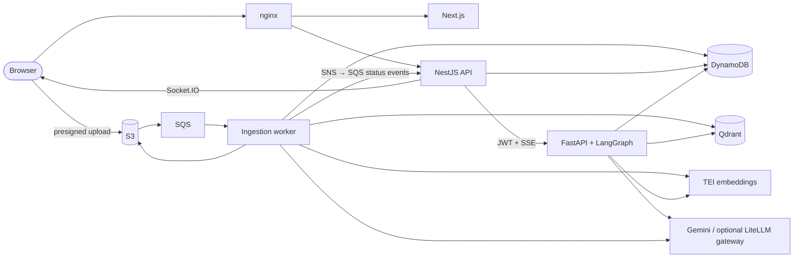
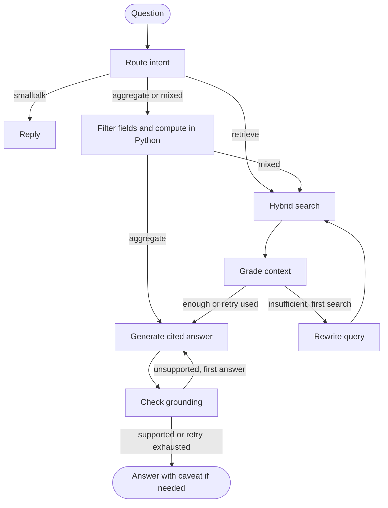

# Architecture

Documents combines asynchronous document ingestion with a tenant-scoped question-answering service. See [Results](RESULTS.md) for measurements and the [AI service guide](../services/ai/README.md) for configuration, commands and evaluation methodology.

## Services and data flow

| Component | Responsibility |
|---|---|
| `frontend/` | Document library, extracted fields, streamed chat and page-level citation highlights |
| `services/api/` | Authentication, presigned uploads, document records, conversations, chat proxy and status events |
| `services/ai/src/docai/api`, `agent` | Internal chat service; independently validates the user's JWT and executes the graph |
| `services/ai/src/docai/ingest` | Parsing, extraction, indexing and deletion through the SQS consumer |
| Qdrant and TEI | Versioned dense/BM25 index and CPU embeddings from multilingual-e5-small |
| LocalStack, Keycloak, nginx | Local AWS services, identity provider and browser entry point |
| Optional `ops` profile | LiteLLM with PostgreSQL for budgets, plus Prometheus and Grafana |

Model roles are configured through environment variables. With `LLM_GATEWAY_URL` set, chat and ingestion use LiteLLM for per-user/global daily budgets and model fallback. Without it they call Gemini directly. Evaluation judges call their provider directly.

## Upload and ingestion

1. The API creates a `PENDING` document record and a presigned URL. The browser uploads directly to S3.
2. An S3 event reaches SQS. The worker downloads the file, renders a thumbnail and publishes progress through SNS → SQS → API → Socket.IO.
3. Docling parses digital PDFs and DOCX files; Tesseract reads scans and photos in Polish and English. Long PDFs are processed in batches to bound memory. TXT and CSV have direct parsers.
4. Gemini captions figures. Quarantine removes detected instructions and forged source markup from parsed text and captions before field extraction and indexing. Gemini extracts typed invoice, receipt or contract fields; code normalises amounts, dates and currencies.
5. Parsed documents and figures go to S3; typed fields and status go to DynamoDB. Structure-aware chunks retain page numbers and bounding boxes for citations.
6. Each chunk receives document context, a dense embedding and a BM25 sparse vector. Qdrant stores them in the live index, then the document becomes `COMPLETED`.

Failures are retried through SQS and sent to a dead-letter queue after the third attempt; unsupported files are not retried. Deletion events remove all index versions' points and derived S3 artifacts. Content-hash caches reuse parsing and model responses; reindexing reads saved parses without repeating OCR.

Collections are named `chunks_v{N}` behind the `chunks` alias. Rebuilds populate a new version while the worker writes incoming documents to both versions, reconcile changes, then switch the alias atomically. The previous version remains available for rollback.

## Answering a question

The API loads the conversation's scope and recent messages from DynamoDB and forwards them with the user's JWT. The AI service derives tenant identity from the validated token. It streams progress, tokens and citations through the API, which stores the final answer and usage.

- **Retrieval:** dense and BM25 searches are fused by reciprocal rank fusion. Tenant and conversation filters apply in code.
- **Calculations:** the model proposes a structured plan; the metadata tool computes sums, counts, averages and comparisons with Python `Decimal` over extracted fields.
- **Answers:** numbered sources supply the citations. A computed-value check and a model grounding check can trigger one regeneration. Unsupported answers after that receive a caveat.
- **Limits:** at most two searches, one regeneration, 10 model calls and 40,000 estimated input tokens per request; tools are read-only.

The graph keeps conversation state in DynamoDB through the API. JSON Schemas in `packages/shared/contracts/` define shared extraction, status and streaming contracts for Python and TypeScript.

## Storage

| Store | Data |
|---|---|
| S3 | `uploads/{userId}/{docId}/`, thumbnails and `parsed/{userId}/{docId}/` artifacts |
| DynamoDB | User-owned documents, extracted fields, conversation scope and messages with citations, usage and trace IDs |
| Qdrant | Chunk text, context, dense/sparse vectors, tenant/document identifiers, pages and bounding boxes |
| Gateway PostgreSQL | Virtual keys, budget configuration and spend records |

## Security

Tenant IDs come from validated tokens and are applied to every search and metadata read. Conversation scope cannot grant access to another user's documents. The tenant-isolation suite exercises crafted filters and scopes.

Prompt-injection controls include ingest quarantine, escaped source delimiters, source-only URL filtering, computed-value checks and grounding checks. Planted factual claims can still affect answers and extracted fields; the [attack results](RESULTS.md#prompt-injection-and-tenant-isolation) separate tuned attacks from held-out paraphrases.

Before traces leave the services, tax IDs, PESEL numbers, bank accounts, email addresses and phone numbers become typed keyed hashes. Names and addresses are not detected. This protects trace exports; Gemini and local caches still receive document content.

With the gateway enabled, budgets cover chat and ingestion, and calls are refused when its database cannot validate the virtual key. Provider errors can route to the configured fallback model.

## Prompts and observability

Seven chat prompts live in code and can be versioned in Langfuse. Candidate evaluation pins versions and text hashes at its start. Promotion reads the passing evaluation record, verifies the hashes and moves `production` to exactly those versions; rollback restores `previous`. Runtime serving uses the SDK cache and falls back to code prompts if Langfuse is unavailable. Evaluation of a remote label fails if its prompts cannot be resolved.

W3C trace context connects the API, AI service, graph nodes, retrieval and gateway into one trace per question. New uploads have a worker trace. Prometheus collects request latency/errors, node timings, model usage/cost, fallbacks, budget refusals and queue metrics. Grafana provisions the dashboard and alerts. See the [operating guide](../services/ai/README.md#telemetry) for endpoints and checks.

## Key decisions

| Decision | Reason |
|---|---|
| Contextual hybrid search | Context improved dev MRR@10 from 0.855 to 0.909; BM25 preserves identifiers and amounts that dense search can miss. |
| Small multilingual embedder, no reranker | snowflake-arctic-embed-m-v2.0 scored MRR@10 0.908 against 0.909, at twice the memory and three times the query latency. The cross-encoder reranker lowered MRR@10 from 0.909 to 0.799 and added over 4 s per query. Parent expansion reached 0.912 for three times the text. |
| Whole-word BM25 | Prefix stemming for Polish helped BM25 alone but not with contexts: MRR@10 0.883 against 0.909. |
| Layered injection defences | Quarantine at ingest, the URL filter, a within-document conflict rule and a computed-value check cut attack success from 42.4% to 9.1%. |
| Arithmetic in Python | Structured plans and `Decimal` make financial calculations inspectable and keep arithmetic out of answer generation. |
| Parsed artifacts and versioned collections | Extraction can be reused across retrieval experiments; index changes can be switched and rolled back without repeating OCR. |
| Promotion from a pinned evaluation | A candidate label can change while evaluation runs. Recorded versions and hashes bind promotion to the prompts actually evaluated. |
| OTLP metrics for CloudWatch | Histogram buckets are retained for latency percentiles. |

The [results](RESULTS.md) contain the comparisons.

## AWS

The [CDK guide](../infrastructure/cdk/README.md) owns the AWS topology, configuration, cost estimate and integration requirements: CloudFront, ECS Fargate, managed storage and queues, Secrets Manager, gateway RDS and CloudWatch telemetry.
