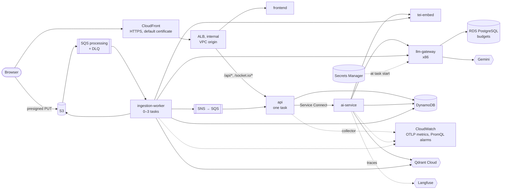

# AWS infrastructure

CDK v2 definitions for `DocumentsInfraStack` (network, storage, queues, edge, repositories, secrets and the gateway database) and `DocumentsServicesStack` (ECS Fargate services, scaling and alarms). The [application architecture](../../docs/ARCHITECTURE.md) describes the data flow.

The account and region come from deployment credentials. Synthesis performs no account lookups, so checks can run without AWS credentials.

## Topology



| Component | Configuration and reason |
|---|---|
| Edge | CloudFront reaches an internal ALB through a VPC origin; `/api/*` and `/socket.io/*` route to the API. HTTPS uses CloudFront's default domain. |
| Services | Six Fargate services in private subnets, each with its own task role and security group. Arm images except the amd64 gateway. |
| Internal routing | Service Connect on `documents.local`; two-minute request timeouts for chat, 30 seconds for TEI. |
| Worker | Queue backlog scales it from zero to three tasks; scale-in waits for an empty queue, including in-flight messages. |
| API and gateway | One task each: API status events share an SQS queue; LiteLLM holds budget counters in memory between database writes. |
| Gateway database | RDS PostgreSQL; the AI service runs the idempotent `docai gateway setup` at startup. |
| Data and identity | S3, DynamoDB, SQS with a dead-letter queue, SNS and Cognito; Qdrant Cloud supplies the search index. |
| Secrets | Secrets Manager supplies provider keys and database credentials at task startup; only the gateway receives the Gemini key. |
| Telemetry | ADOT sidecars scrape the API, AI service and worker and export OTLP metrics to CloudWatch, preserving histogram buckets. PromQL alarms cover service metrics; queue alarms use SQS metrics. Traces go to Langfuse. |
| Network | Two availability zones, one NAT gateway, S3/DynamoDB gateway endpoints and flow logs of rejected traffic. |

Stack definitions are in `lib/infra-stack.ts` and `lib/services-stack.ts`; collectors and alarms in `lib/collector.ts` and `lib/alarms.ts`. `lib/config.ts` defines inputs, and `lib/nag.ts` records accepted cdk-nag findings with their reasons.

## Checks

```bash
npm ci
npm run check            # TypeScript
npm test                 # assertion tests and cdk-nag's AWS Solutions checks
npx cdk synth --quiet    # fails on any cdk-nag or CloudFormation finding not accepted
npm run cost             # the cost estimate, as the table below
```

CI runs the first three on every push, then scans the templates for account IDs and keys. `services/ai/evals/collector_check.py` runs the collectors' configuration beside the local stack.

## Cost estimate

The estimate is computed from the synthesized stacks; a test keeps this table equal to `npm run cost`:
- **Prices:** US East list prices recorded in the [pricing model](lib/cost.ts).
- **Quantities:** read from the synthesized templates (`npm run cost`).
- **The demo month:** the demo library seeded once (141 uploads) and 300 questions.

<!-- cost-estimate:start -->
| Item | Basis | Idle month | Demo month |
| --- | --- | --- | --- |
| Fargate: api | 0.5 vCPU, 1 GB, Arm; 1 task | $14.42 | $14.42 |
| Fargate: frontend | 0.25 vCPU, 0.5 GB, Arm; 1 task | $7.21 | $7.21 |
| Fargate: ai-service | 0.5 vCPU, 2 GB, Arm; 1 task | $17.02 | $17.02 |
| Fargate: ingestion-worker | 2 vCPU, 4 GB, Arm; 0 tasks idle, 1.5 task-hours under the demo | $0.00 | $0.12 |
| Fargate: tei-embed | 0.5 vCPU, 2 GB, Arm; 1 task | $17.02 | $17.02 |
| Fargate: llm-gateway | 0.5 vCPU, 1 GB, x86; 1 task | $18.02 | $18.02 |
| NAT gateway | 1 gateway and 1 public IPv4 address; 1 GB idle, 3 GB under the demo | $36.55 | $36.63 |
| Load balancer (internal) | 1 ALB, no public address; CloudFront in front, within its free tier | $16.72 | $17.59 |
| RDS PostgreSQL (the gateway's) | db.t4g.micro, Single-AZ, 20 GB gp3 | $13.98 | $13.98 |
| Secrets Manager | 7 secrets | $2.80 | $2.80 |
| CloudWatch alarms | 3 PromQL; 7 alarm metrics; 6 from target tracking | $1.60 | $1.60 |
| CloudWatch metrics and logs | OTLP metrics, a scrape a minute (0.75 GB); logs 0.5-1 GB | $0.62 | $0.87 |
| ECR | about 6 GB of image layers | $0.60 | $0.60 |
| S3, DynamoDB, SQS, SNS, CloudFront | usage-priced; at the demo scale within free tiers or cents | $0.00 | $0.00 |
| **AWS total** | | **$146.55** | **$147.88** |
| Gemini, outside AWS | 300 questions, 141 uploads | $0.00 | $1.57 |
<!-- cost-estimate:end -->

Nearly all of it runs whether anyone uses it or not:
- **Always-on services:** $74.
- **The NAT gateway:** $37.
- **The load balancer:** $17.
- **The gateway's database:** $14.

The worker costs nothing while idle.

## Deploying

Resolve the [Cognito integration requirements](#integration-requirements) before using the sign-in flow. The manual `.github/workflows/deploy.yml` workflow uses OIDC and follows these steps:
1. **Deploy the infra stack:** the repositories and CloudFront's address.
2. **Build and push the five images**, tagged with the commit. The frontend is built for that address, and the gateway's image is amd64.
3. **Deploy the services stack.**

Before the first services deploy, put the keys into Secrets Manager:

```bash
npx cdk bootstrap                                    # once per account and region
../scripts/setup-oidc.sh                             # the role deploy.yml assumes: CDK's roles and ECR pushes, main only
aws secretsmanager put-secret-value --secret-id documents/gemini-api-key --secret-string "$GEMINI_API_KEY"
aws secretsmanager put-secret-value --secret-id documents/qdrant-api-key --secret-string "$QDRANT_API_KEY"
aws secretsmanager put-secret-value --secret-id documents/langfuse \
  --secret-string '{"publicKey": "...", "secretKey": "..."}'
aws secretsmanager put-secret-value --secret-id documents/litellm-master-key --secret-string "sk-$(openssl rand -hex 24)"
aws secretsmanager put-secret-value --secret-id documents/llm-gateway-key --secret-string "sk-$(openssl rand -hex 24)"
# documents/masking-key and the database's password are generated by CloudFormation
```

| Input | Description |
|---|---|
| `COGNITO_USER_POOL_ID`, `COGNITO_CLIENT_ID` | The user pool and a public app client with `USER_PASSWORD_AUTH` |
| `QDRANT_URL` | The Qdrant Cloud cluster |
| `LANGFUSE_BASE_URL` | Default `https://cloud.langfuse.com` |
| `ALLOWED_ORIGINS` | Optional: origins besides CloudFront's, such as a custom domain |
| `-c imageTag=<commit>` | The images to run; ECR tags are immutable |
| `CDK_REQUIRE_DEPLOY_CONFIG=true` | Makes a missing input an error instead of a placeholder (set by `deploy.yml`) |

`npx cdk destroy --all -c removalPolicy=destroy` removes a throwaway environment; otherwise the bucket, the table, the repositories and the secrets are kept, and the database leaves a snapshot.

## Integration requirements

- **Cognito:** the current sign-in flow requires two code changes: validate access tokens using `client_id` in the API and AI service, and add an address-confirmation step before signing in a newly registered user. The current validators expect `aud`, and sign-up immediately attempts sign-in.
- **Edge**: no WAF, and CloudFront's default certificate, since there is no custom domain.
